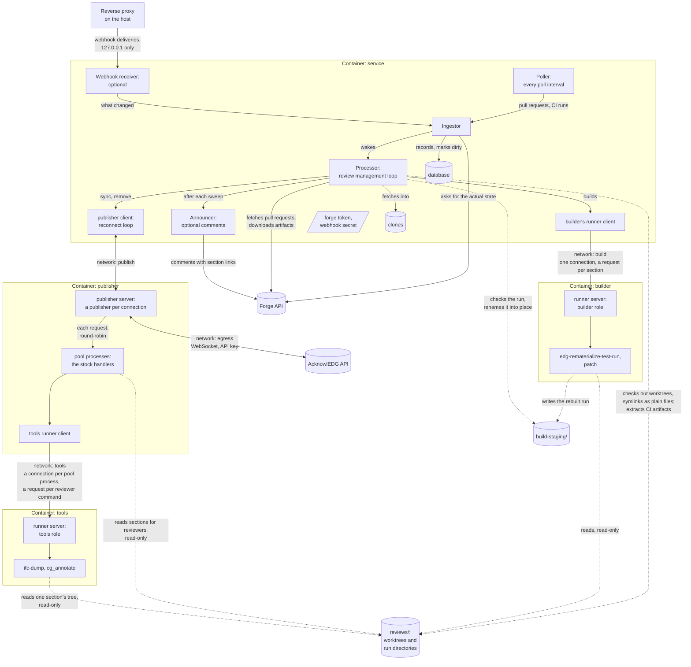
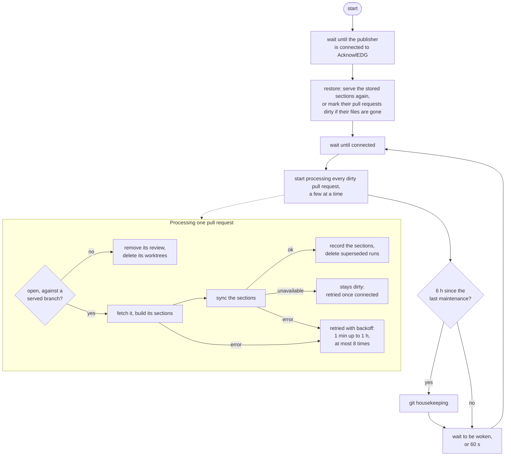
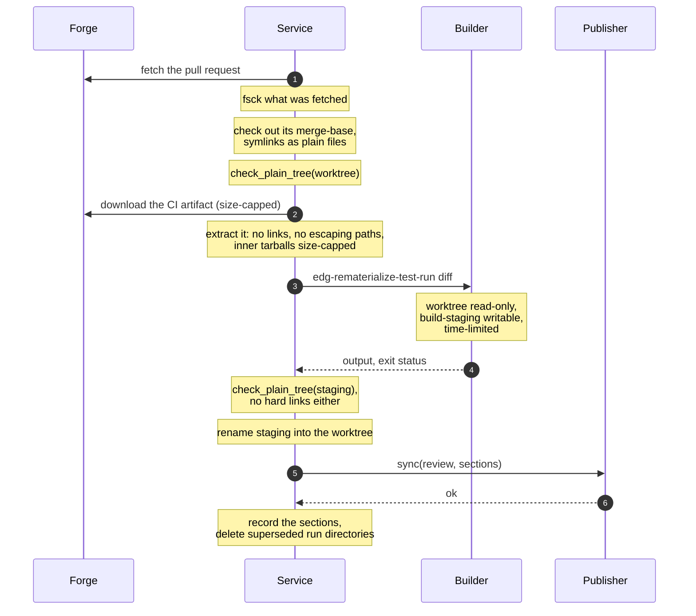
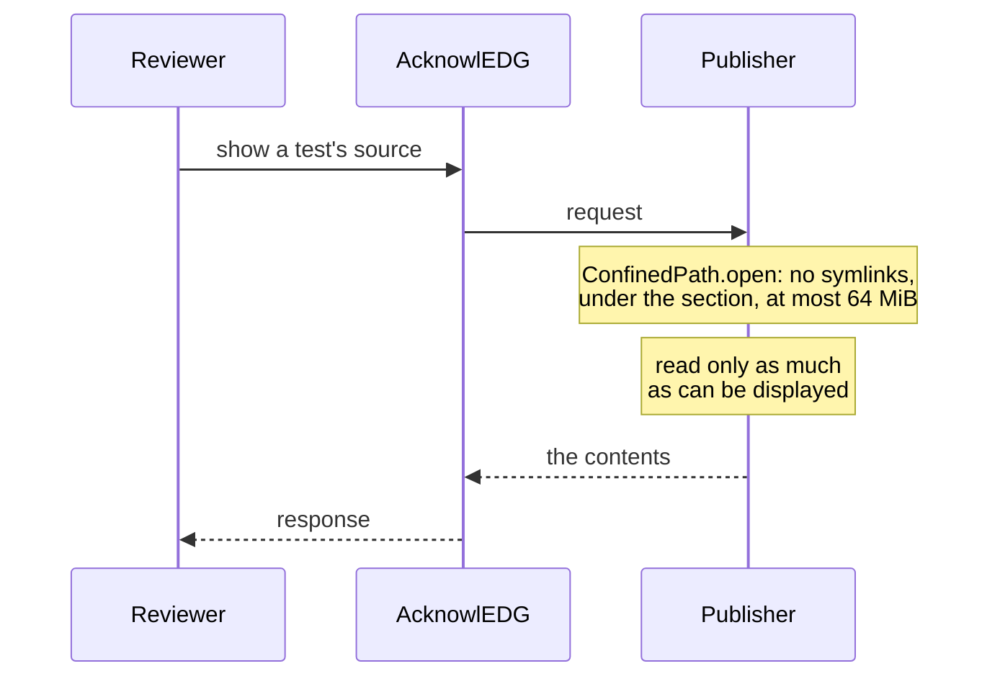
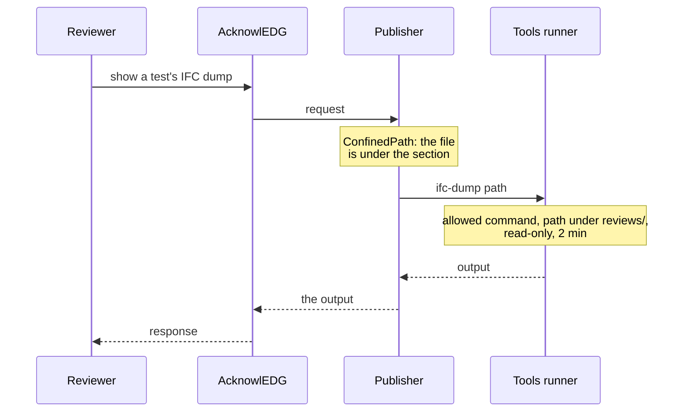
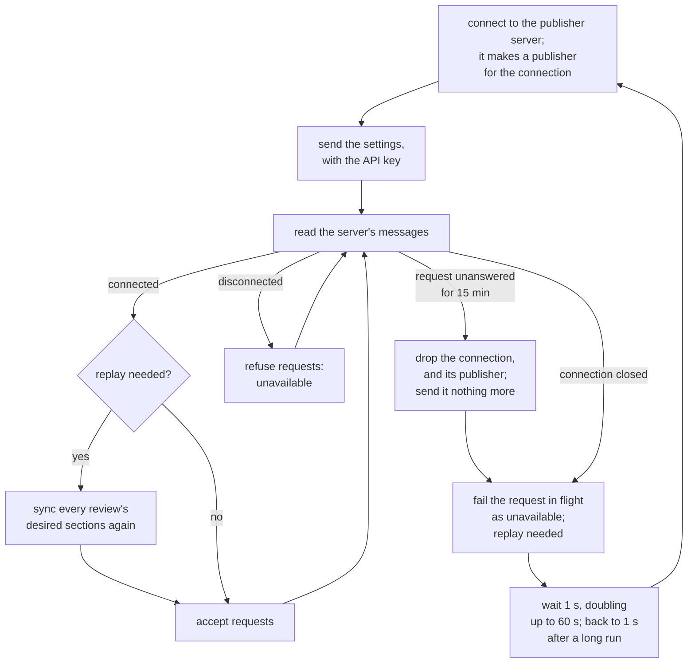
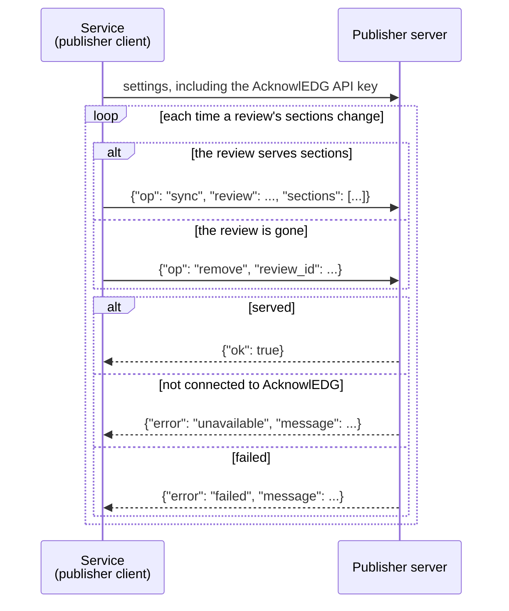
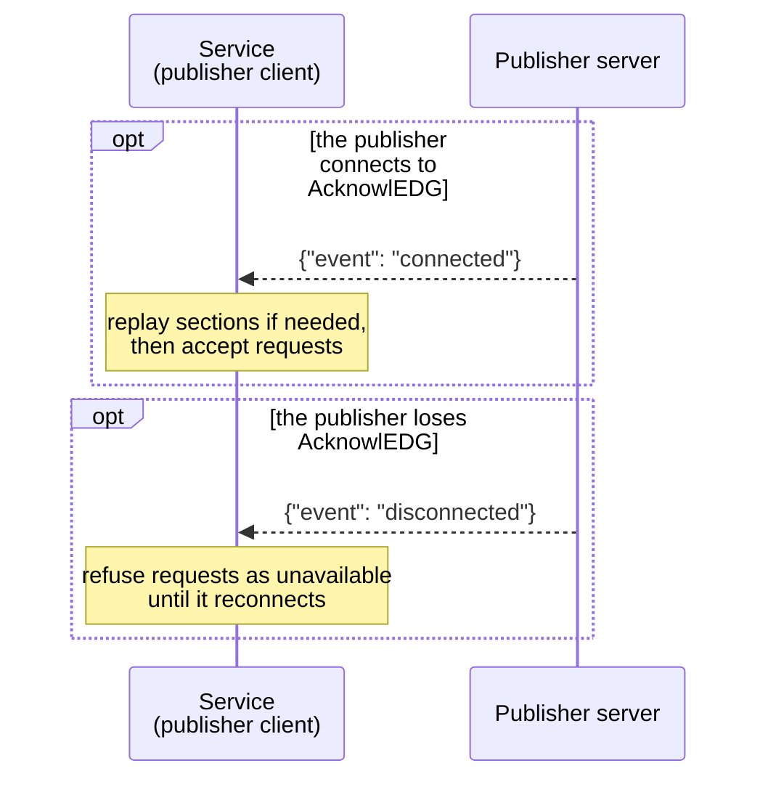

# Sandboxing in acknowledg-forge

acknowledg-forge builds review sections out of pull requests and the CI
artifacts their runs produce, and serves them to reviewers. All of that
content is untrusted: anyone who can open a pull request controls it. This
document describes how the service keeps that content away from what it
protects, and what a host must provide for it to work.

## What is protected

The service holds things a pull request must never reach:

- the forge token (which can comment on, and read, every served repository)
  and the webhook secret;
- the database;
- the clones, and every other pull request's review trees;
- the host itself, and the service's memory and disk.

The AcknowlEDG API key is the one secret the process serving reviewers
holds; it only lets that process publish review sections.

## Layers

No single mechanism is relied on. In order, from outermost:

1. **The containers.** A deployment is four Docker containers
   ([`compose.yaml`](compose.yaml)), one per role, each seeing only the
   files and networks its role needs. Everything that reads pull request
   content runs outside the service's container, away from its secrets.
2. **What enters the service.** The EDG tooling comes from a frozen,
   reviewed copy (`ACKNOWLEDG_FORGE_TOOLS_DIR`; the image embeds one), never
   from a pull request. A pull request's diff is only ever input to `patch`.
   Checkouts and artifacts are checked before anything reads them (see
   [Symlinks and links](#symlinks-and-links)).
3. **Narrow interfaces.** The containers reach each other only over
   WebSockets, each pair on a network of its own that no other container
   shares. The runners run only the commands they allow, on paths under
   their mounts, with a cleared environment.
4. **Confined reads.** The code answering reviewers opens files without
   following symlinks, only under the section's tree, and only up to a size
   limit.
5. **Resource limits.** Timeouts, size caps, bounded `/tmp`s, and each
   container's memory and process limits.

## Processes



The service container is the only one holding the forge token, the webhook
secret, the database, and the clones. The service never reads pull request
content beyond checking its shape; reading it is left to the other
containers. The processor's loop is described under
[Managing reviews](#managing-reviews), and the publisher's under
[The publisher](#the-publisher).

### Names

Every connection between containers is a server, in one container, and its
client, in another, and the code is named that way: each container's name
in `compose.yaml` is the package it runs (`python -m
edgacknowledg.forge.<container>`), what listens in it is a `…Server`
(`server.py`), and what reaches it is a `…Client` (`client.py`).

| Container | Runs | Its server | Its client, in |
| --- | --- | --- | --- |
| `service` | `acknowledg-forge-github` (`edgacknowledg.forge.service`, `processor`, …) | (webhooks only) | — |
| `builder` | `edgacknowledg.forge.builder` | `RunnerServer` with the builder role (`runner.server`, `runner.roles`) | `RunnerClient` (`runner.client`), in the service, through `Sandbox.run` |
| `publisher` | `edgacknowledg.forge.publisher` | `PublisherServer` (`publisher.server`), hosting an `AcknowledgPublisher` (`publisher.acknowledg`) per connection, and the `ProcessPool` (`publisher.pool`) of pool processes (`publisher.pool_process`) answering its reviewers | `PublisherClient` (`publisher.client`), in the service |
| `tools` | `edgacknowledg.forge.tools` | `RunnerServer` with the tools role | `RunnerClient`, in each pool process, through `Sandbox.context_for` |

The builder and tools containers run the same server, the runner, with a
role each. `publisher.protocol` is the publisher's messages; `publisher`
itself is the `Publisher` interface the processor publishes through. Without
containers, `local` serves all three servers from the service's process.

## What each container sees

All four containers run from the same image and get:

- the host account that owns the deployment's state as their user (never
  root), no capabilities, and `no-new-privileges`;
- a read-only root file system, with the frozen tools under `/edg/tools`;
- a 512 MiB tmpfs `/tmp`;
- an init process that reaps whatever their commands leave behind, and
  memory and process-count limits;
- Docker's default seccomp profile (and AppArmor profile, on hosts using
  AppArmor), which, among other things, stops them from creating user
  namespaces.

Each mounts only its part of the deployment's state directory, at the same
path in every container (`/var/lib/acknowledg-forge`), so paths in messages
need no translation.

| Container | Runs | Sees | Writes | Networks | Holds |
| --- | --- | --- | --- | --- | --- |
| `service` | the service (`acknowledg-forge-github` or `-gitlab`) | the whole state directory | the whole state directory | `frontend` (the forge; webhooks from the host), `build`, `publish` | the credentials |
| `builder` | a runner server (builder role): `edg-rematerialize-test-run` only | `reviews/` | `build-staging/` only | `build` (internal) | nothing |
| `publisher` | the publisher server: `AcknowledgPublisher`, and pool processes running the stock handlers | `reviews/` | nothing | `publish` (internal), `tools` (internal), `egress` (AcknowlEDG) | the API key, in the server's memory |
| `tools` | a runner server (tools role): `ifc-dump` and `cg_annotate` only | `reviews/` | nothing | `tools` (internal) | nothing |

- **Networks.** Each pair of containers that talk shares a network of its
  own, and no other: the builder can't reach the publisher or the tools
  runner, nor they it. Internal networks have no route out, so the builder
  and tools runner can reach nothing but their one client. A listener on a
  container with several networks binds only on its pair's (the publisher
  server on `publish`; the webhook receiver, with
  `ACKNOWLEDG_FORGE_WEBHOOK_BIND=service-frontend:2728`, on `frontend`).
  That is what keeps each server to its one client: the connections carry
  no credentials of their own, so `tests/test_containers.py` checks every
  pairing, and a change to the networks in `compose.yaml` that breaks one
  fails it.
- **Published ports.** Only the webhook port, and only on the host's
  `127.0.0.1`, for a reverse proxy there to expose. Docker's published
  ports bypass the host's firewall, so the address stays the loopback one.

### Runners

The builder and tools containers each run a runner server
(`runner.server`), with their role's allowed commands, roots, and variables
(`runner.roles`), which are defined in the code, so they are the same with
or without containers. Each client keeps one connection open, and sends
each command as a request on it, with an id that its output and answer
carry, so commands run concurrently over it. For each, the runner:

- runs it only if it starts with an allowed prefix (e.g. `python3
  /edg/tools/bin/edg-rematerialize-test-run`), with the program resolved on
  the runner's own `PATH`;
- refuses any absolute path, in the arguments, the working directory, or a
  variable, outside its roots (its mounts), and any variable it doesn't
  allow (only `EDG_TEST_HOME`, for the builder);
- runs it with a cleared environment (`PATH`, `HOME=/tmp`, `LC_ALL`,
  `PYTHONPATH` for the frozen tools), in a session of its own, and kills
  its process group when it ends, times out (the builder: the service's
  `ACKNOWLEDG_FORGE_REMATERIALIZE_TIMEOUT`; tools: 2 min), its client
  cancels it, or the connection goes (which kills every command on it);
- once no command is running, kills every other process left in the
  container and empties `/tmp`.

The service has one runner client, for its builds. Each pool process has
one too, for the commands its handlers run: they run every command through
their `SandboxContext` (`run_command`), whose command runner is that
client. A client connects when first used, and again when its connection
goes, which fails the commands in flight on it.

### Trade-offs

Two deliberate choices, and what limits them:

- **The containers are long-lived.** The builder and tools runners serve
  every pull request, not one each. A pull request that compromises a
  command could leave something behind for later ones, or interfere with
  one running at the same time. Against that: between commands the runner
  kills every stray process and empties `/tmp`; the root file system is
  read-only; the builder can write only `build-staging/`, which the service
  checks before using anything in it; and neither runner has a network to
  send anything out on.
- **Docker runs as root.** The containers don't (see above), but an escape
  through the kernel or the container runtime would reach the host as root,
  where a rootless setup would reach only an unprivileged account. That is
  what the containers' limits (no capabilities, `no-new-privileges`,
  seccomp, AppArmor, read-only root file systems) guard against.

## Managing reviews

The processor (`Processor.run`, in the service) decides what each review
serves: it builds sections from pull requests through the builder, and
hands them to the publisher to serve.

### Review management loop



### Building a section

The "fetch it, build its sections" and "sync the sections" steps of that
loop, for one section:



A failed check fails the section rather than serving it. Superseded run
directories are deleted only after the publisher confirms it no longer
serves them. Staging directories a restart interrupted are deleted at startup.

## Serving reviewers

Reviewers' requests reach the publisher through AcknowlEDG. Most are
answered by the publisher itself; those needing a tool go to the tools
runner.

### Test source (answered by the publisher)



### IFC dump (delegated to the tools runner)



Bench sections' annotated profiles (`cg_annotate`) take the same path.

Sections are read-only: reviewers can't accept diffs or update baselines
through the service.

## The publisher

The publisher container runs the publisher server (`PublisherServer`),
which serves reviewers with `AcknowledgPublisher`, acknowledg-forge's
AcknowlEDG client. It holds one batch connection to AcknowlEDG and manages
each review's sections; the stock providers from `edgacknowledg.client`
(`TestSourceHandler`, `BenchReviewSession`), the same handlers that
`edgy-review` and `edg-bench-review` use, answer reviewers' requests in its
process pool. The service drives it through the publisher client
(`PublisherClient`), which implements the same `Publisher` interface, so
the rest of the service doesn't know the publisher is elsewhere.

Each connection from the client gets an `AcknowledgPublisher` of its own,
made from the settings the client sends first; when the connection goes, so
does that publisher, with everything it served. A new connection replaces
the current one.

### The process pool

Answering a reviewer reads, parses, diffs, and decompresses pull request
content, which can take long, or forever. So the server only manages
sections, and answers every request in its process pool (`ProcessPool`),
which its event loop never waits on for more than a request's deadline:

- Each section is registered with a `UnixSocketHandler`, which stands in
  for the section's handler: it passes each request, with the section it
  is for, to the pool, and relays the replies.
- The pool keeps a fixed number of pool processes (`--processes`, 4), each
  with one end of a socket pair as its channel, and sends each request to
  the next one in turn (round-robin). A process answers one request at a
  time, building the section's handler for it and dropping it afterwards;
  requests for a busy process wait their turn.
- A request has a deadline (`--request-timeout`, 150 s, longer than the
  tools runner's 2 min), counted from when its process starts on it. A
  process that misses it is killed, with whatever it started, and
  replaced; so is one that exits. Either way that request fails, and the
  client library answers the reviewer with its failure reply; a request
  for a file outside the section still gets the reviewer dropped.
- A process that exits before it is ready has failed to start: the next
  try waits, doubling from 1 s up to 60 s, and until then requests for it
  fail at once. The server doesn't start unless every process does.

The client library answers one request at a time per section, so one
section's requests occupy at most one process at a time.

### Reconnect loop

The publisher client keeps one connection up, and makes sure the next
connection's publisher serves whatever the last one did:



At startup, the service checks that it can reach the builder
(`Sandbox.check`), and refuses to start otherwise. Nothing checks the tools
runner up front: only requests that run a command (`ifc-dump`,
`cg_annotate`) need it, so while it can't be reached, those fail, each with
the client library's failure reply, and everything else is still served.

Without containers (`ACKNOWLEDG_FORGE_UNSANDBOXED=1`, for local
development only), all of this is the same: the service runs the publisher
server and both runner servers itself (see [Development](#development))
and reaches them the same way.

### Messages

The client and the server exchange JSON objects, one per WebSocket text
message (`publisher.protocol`).

#### Requests

After the settings, the service sends a request each time a review's
sections change, and waits for its answer:



- The API key goes over the connection, not a command line or
  environment, where `/proc` would show it, nor a file in the publisher
  container.
- Requests go one at a time, so each answer belongs to the request in
  flight. `unavailable` defers the pull request until the connection is
  back; `failed` fails it.

#### Connection events

Separately, and only when its AcknowlEDG connection changes, the
connection's publisher reports it, at any time between answers:



## Symlinks and links

A pull request can commit symlinks, and the builder's command could create
them. Several layers keep the service from reading through one:

- Clones check symlinks out as plain files holding the link's target
  (`core.symlinks=false`), so no worktree contains one. Symlinked tests
  therefore show their target path rather than its contents.
- Clones fsck everything they fetch (`transfer.fsckObjects`), refusing
  malformed trees.
- After every checkout, a worktree may hold only directories and regular
  files (`check_plain_tree`). So may what `edg-rematerialize-test-run`
  writes, which also may not hold hard links.
- The section's directories, including the bench baselines a pull request
  supplies, must be real directories.
- CI artifacts may not contain links or escaping paths, nor may the
  `.rt.tar.gz` files inside them. Reading those tarballs later refuses link
  members as well.
- The handlers open files through `ConfinedPath`, which opens each path
  component with `O_NOFOLLOW` relative to the last, so a symlink anywhere
  on the way is refused, even one created after a check. A refused path
  ends the reviewer's connection.
- The service refuses to write through symlinks.

## Resource limits

| Resource | Limit |
| --- | --- |
| Artifact download | `ACKNOWLEDG_FORGE_MAX_ARTIFACT_BYTES` (256 MiB), also counting the decompressed size of inner tarballs |
| A file read for a reviewer | 64 MiB; a larger one fails the request |
| A source shown to a reviewer | only as much as can be displayed is read |
| Each container's `/tmp` | 512 MiB tmpfs; copies made for diffing are streamed there |
| Build commands | `ACKNOWLEDG_FORGE_REMATERIALIZE_TIMEOUT` (15 min) |
| Reviewer commands | 2 min |
| A reviewer's request | 150 s in a pool process, which is then replaced |
| Each container | `mem_limit` (the service, builder, and publisher 2 GiB, tools 1 GiB) and 512 processes ([`compose.yaml`](compose.yaml)) |

## Secrets

Secrets belong in systemd credentials, which the host's unit decrypts and
[`prepare-runtime.sh`](prepare-runtime.sh) hands to the service container
only, in memory (`/run`), never on disk unencrypted. A secret passed in an
environment variable is readable from the process's own
`/proc/self/environ`, so the service warns at startup when sandboxing is on
and a secret came from the environment.

Comments the service posts contain only fixed text, commit hashes, and
links it generates.

## Host requirements

Docker Engine with Compose 2.17 or later, run as usual (the daemon as root;
see the trade-off above), and systemd, which starts the deployment and
holds its credentials (see [README.md](README.md#host-setup-once)). Nothing
else: unlike a sandbox nested in a container, the containers need no
unprivileged user namespaces, so hosts that restrict them (Ubuntu 24.04 and
later, with AppArmor) need no changes, and no AppArmor profile.

## Development

`ACKNOWLEDG_FORGE_UNSANDBOXED=1` runs without containers, for local
development only. The control flow stays the same: the service serves the
builder and tools runner servers and the publisher server itself
(`edgacknowledg.forge.local`), on `127.0.0.1`, and uses them as it uses the
containers, so they allow the same commands and paths. Only the
containers' confinement is missing: the publisher server runs in the
service's process, and its pool processes and the commands, though separate
processes with cleared environments, see and can reach everything the
service can. And with no
networks to keep the servers to their one client, any process on the
machine can reach them, so use it on a single-user machine only. A tool
that isn't installed (e.g. `cg_annotate`) is refused when asked for, rather
than stopping the service.

To run the containers locally, build the image (`build-edg-env
acknowledg-forge`); `tests/test_containers.py` brings a deployment up with
it and checks the table above from inside each container:

```
ACKNOWLEDG_FORGE_TEST_IMAGE=ghcr.io/edgcpp/acknowledg-forge:latest \
  tests/run-tests.sh test_containers.py
```
